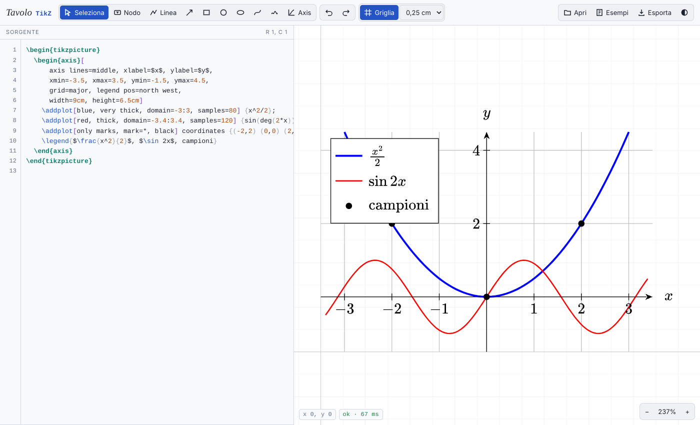

# Tavolo TikZ

[](https://giozoc.github.io/tavolo-tikz/)
[](#stack-tecnologico)
[](#funzionalità)
[](#licenza)



---

## Documentazione

Tavolo TikZ è un **editor visuale per figure TikZ e grafici pgfplots** che funziona interamente nel browser, senza installare nulla e senza compilare con LaTeX a ogni modifica.

- **Demo online**
  L'editor pubblicato con GitHub Pages:
  👉 <https://giozoc.github.io/tavolo-tikz/>

- **Contenuto del repository**:

  * Interprete TikZ scritto da zero in JavaScript (percorsi, nodi, `\foreach`, scope, stili)
  * Motore pgfplots per gli ambienti `axis` e i comandi `\addplot`
  * Interfaccia con editor del codice, area di disegno e pannello proprietà
  * Esempi `.tex` compilabili con pdfLaTeX per il confronto con l'anteprima

---

## Panoramica del Progetto

Scrivere figure in TikZ significa di solito modificare un numero, ricompilare, guardare il PDF e ripetere. Tavolo TikZ accorcia questo ciclo: il codice a sinistra e il disegno a destra restano **sincronizzati nei due sensi**.

- ogni modifica al codice si vede **subito** nel disegno
- spostando, ruotando o ridimensionando un elemento sul disegno, l'editor **riscrive solo i numeri interessati**, lasciando intatta la formattazione del codice (a capo, spazi, commenti)
- gli **ambienti `axis` di pgfplots funzionano davvero**: limiti automatici, griglie, legende, barre, scale logaritmiche, aree tra curve
- i **testi dei nodi** si modificano dal pannello (corpo, posizione, colore) e si spostano trascinandoli, anche quando stanno dentro un `\draw`
- il risultato si esporta come **codice TikZ**, **documento `standalone`** con le librerie necessarie, **SVG** o **PNG**

> L'anteprima è fedele ma non identica a pdfLaTeX: per la versione finale conviene sempre compilare il codice esportato.

---

## Funzionalità

**pgfplots**
- `axis`, `semilogxaxis`, `semilogyaxis`, `loglogaxis`
- `\addplot` con funzioni `{x^2}`, parametriche, `coordinates`, `table {…}`, `fill between`
- barre `ybar`/`xbar`, `stacked`, `nodes near coords`, `symbolic x coords`, `xtick=data`
- `axis lines`, `grid`, tick personalizzati, `axis equal`, legende, coordinate `axis cs:`

**TikZ**
- nodi con oltre 25 forme, ancore, `label`, `pin`
- `\foreach` (con `/`, `count`, `evaluate`, `...`), `calc`, `positioning` (`right=of`)
- `to[bend left]`, `loop`, `|-` e `-|`, curve di Bézier, `arc`, `grid`, `plot`
- scope e trasformazioni, alberi (`child`), `matrix of nodes`
- sfumature, pattern, `\clip`, stili `/.style`, `\definecolor`, `\pgfmathsetmacro`

**Modifica visuale**
- strumenti: nodo, linea, freccia (si aggancia ai nodi), rettangolo, cerchio, ellisse, Bézier, mano libera, grafico
- aggancio alla griglia regolabile; **Alt** per spostare liberamente
- campi numerici per ogni punto e frecce da tastiera (**Ctrl + frecce**: passo 0,01)
- rotazione con maniglia o valore in gradi (`rotate`, `rotate around`)
- apertura di file `.tex` con più figure, annulla e ripeti, tema chiaro e scuro

---

## Stack Tecnologico

- **Linguaggio**: JavaScript (ES2020), senza framework né dipendenze da installare
- **Rendering**: SVG generato direttamente dal codice TikZ
- **Testo matematico**: [MathJax 3](https://www.mathjax.org/) (caricato da CDN)
- **Interfaccia**: HTML e CSS, con temi chiaro e scuro
- **Pubblicazione**: GitHub Pages (sito statico)

---

## Architettura

L'editor elabora il codice in una **pipeline a fasi**, rieseguita a ogni modifica:

1. **Scansione** – individua le figure `tikzpicture` nel sorgente e il preambolo (`\definecolor`, `\tikzset`, …)
2. **Interpretazione** – esegue i comandi TikZ, espande `\foreach` e stili, valuta le espressioni pgfmath
3. **Geometria** – calcola percorsi, nodi, ancore e frecce in coordinate di pagina
4. **pgfplots** – per ogni `axis` raccoglie i dati, calcola limiti e tick, poi disegna grafici e legenda
5. **Rendering** – produce l'SVG e registra, per ogni elemento, la posizione dei numeri nel sorgente
6. **Modifica inversa** – quando trascini un elemento, converte la nuova posizione in coordinate e riscrive solo quei numeri

---

## Struttura del Repository

```text
tavolo-tikz/
├── index.html                  # pagina principale
├── css/
│   └── style.css               # stile e temi chiaro/scuro
├── js/
│   ├── 01-core.js              # unità, colori, espressioni pgfmath, geometria
│   ├── 02-style.js             # interpretazione delle opzioni TikZ
│   ├── 03-text.js              # testo LaTeX con MathJax
│   ├── 04-nodes.js             # forme dei nodi, ancore, frecce
│   ├── 05-interpreter.js       # comandi, \foreach, scope
│   ├── 06-path.js              # percorsi e coordinate
│   ├── 07-path-nodes.js        # nodi nei percorsi, alberi, matrici
│   ├── 08-pgfplots.js          # ambienti axis e \addplot
│   ├── 09-render.js            # rendering di una figura
│   ├── 10-ui.js                # editor del codice e vista
│   ├── 11-tools.js             # strumenti, trascinamento, rotazione
│   └── 12-panel.js             # pannello proprietà, esportazione, esempi
├── esempi/                     # figure .tex compilabili con pdfLaTeX
├── docs/
│   └── anteprima.png           # immagine del README
└── LICENSE
```

---

## Avvio

**Online**: apri <https://giozoc.github.io/tavolo-tikz/>.

**In locale**:

1. Clona il repository:

```bash
   git clone https://github.com/giozoc/tavolo-tikz.git
   cd tavolo-tikz
```

2. Avvia un server statico e apri il browser su `http://localhost:8000`:

```bash
   python3 -m http.server 8000
```

   Non servono altri passaggi: i file si caricano così come sono.

3. Per confrontare l'anteprima con LaTeX, compila uno degli esempi:

```bash
   cd esempi
   pdflatex funzioni-pgfplots.tex
```

---

## Scorciatoie

| Tasto | Azione |
|---|---|
| `V` `N` `L` `A` `R` `C` `E` `B` `F` `G` | Seleziona, Nodo, Linea, Freccia, Rettangolo, Cerchio, Ellisse, Bézier, Mano libera, Grafico |
| Frecce | Sposta l'elemento o il punto selezionato (Maiusc: ×4, Ctrl: passo 0,01) |
| Alt + trascina | Sposta o ruota senza aggancio alla griglia |
| Canc | Elimina l'elemento selezionato |
| Ctrl + D | Duplica |
| Ctrl + Z / Ctrl + Maiusc + Z | Annulla / Ripeti |
| `0` | Adatta la vista alla figura |
| Spazio + trascina | Sposta la vista |
| Alt + ↑/↓ nel codice | Aumenta o diminuisce il numero sotto il cursore |

---

## Limiti Noti

Non sono ancora supportati l'operazione `let`, i grafici 3D (`\addplot3`), `groupplot`, le decorazioni e i dati letti da file esterni (`table {dati.csv}`): in questi casi l'editor mostra un avviso e prosegue con il resto della figura.

---

## Ringraziamenti

Ispirato a [tikz-editor](https://github.com/DominikPeters/tikz-editor) di Dominik Peters.

---

## Licenza

Questo progetto è distribuito sotto licenza **MIT**.
